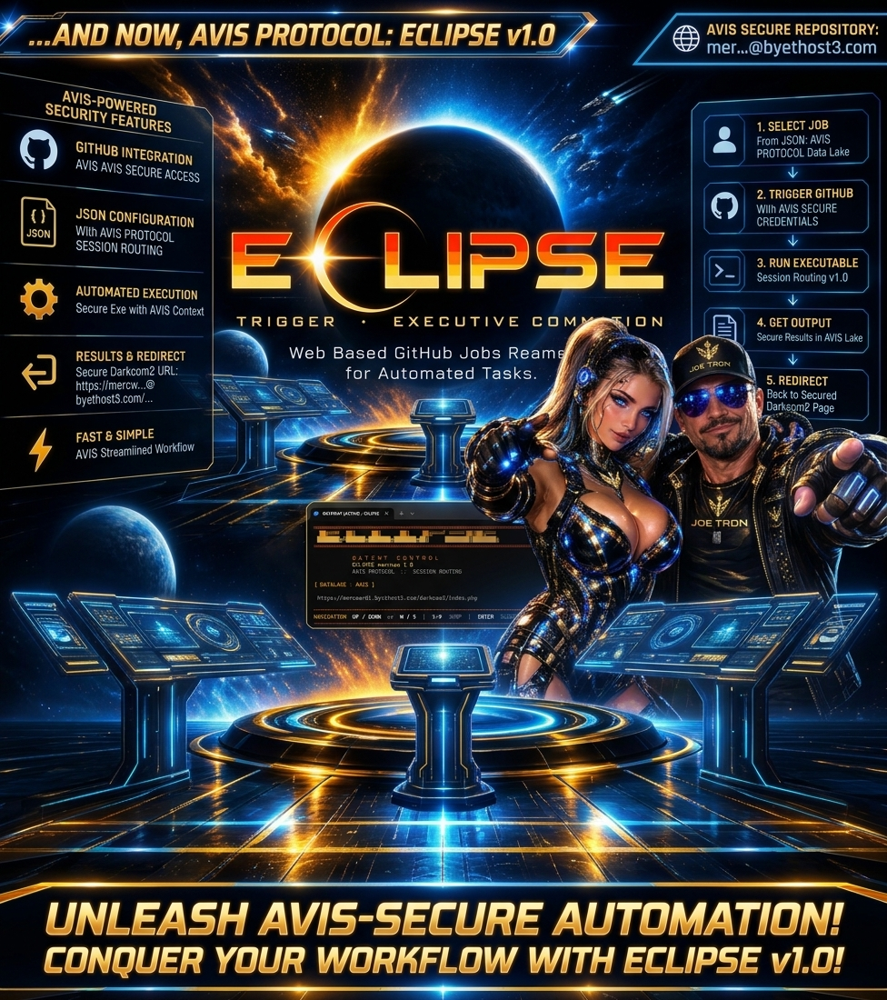
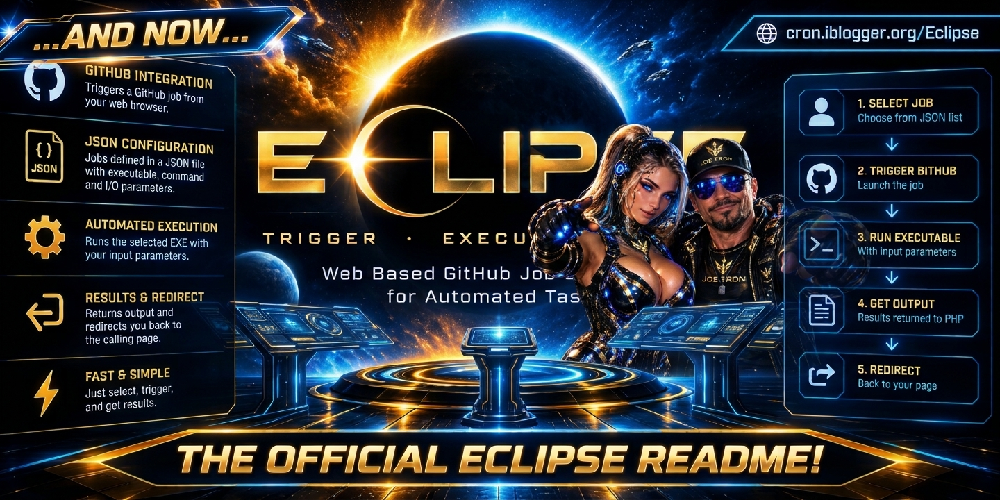
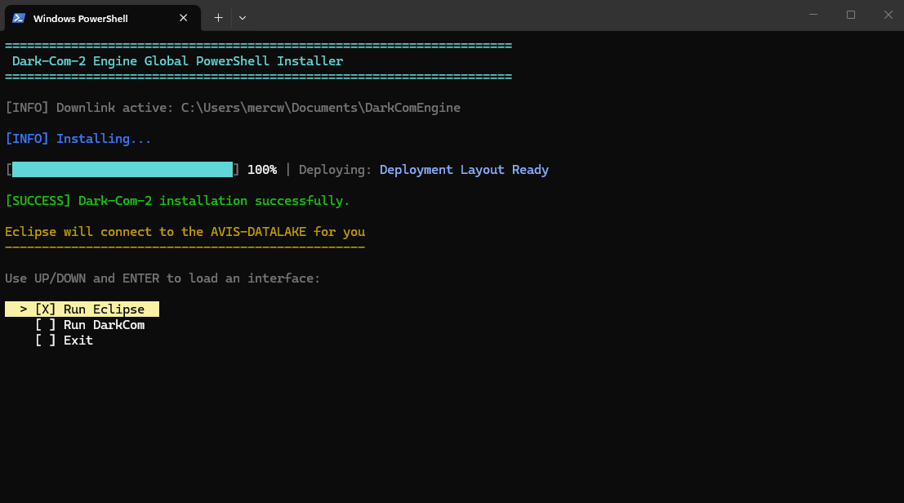
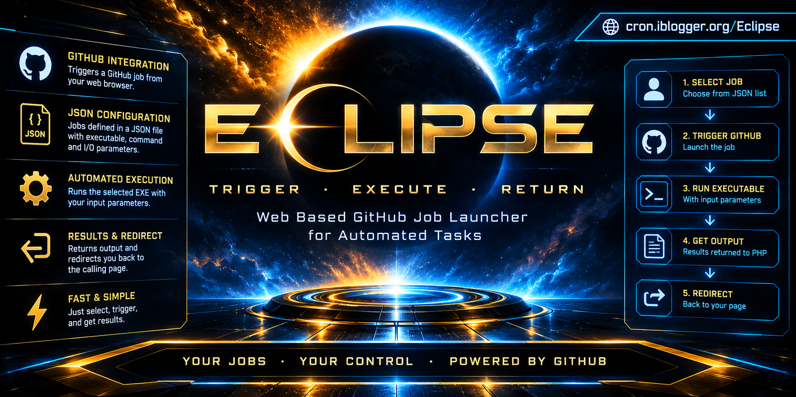
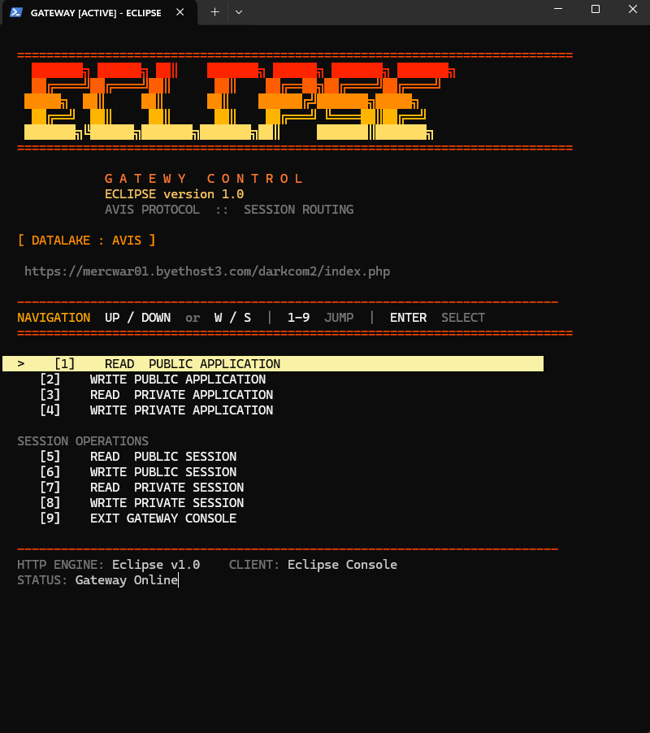
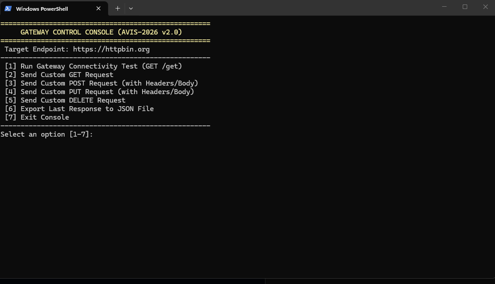

<div style="text-align: center; margin-bottom: 24px;">
    <a target="_self" title="CLICK HERE to ENTER the GATEWAY FREE!" href="https://mercwar.github.io/Constellation/index.html">
    
    </a>
</div>

---

# ✨ ECLIPSE bY Joe Tron 💎🔥

<div style="text-align: center; margin: 24px 0;">
    <a target="_self" title="CLICK HERE to ENTER the GATEWAY FREE!" href="https://mercwar.github.io/Constellation/index.html">
    
    </a>
</div>

# ECLIPSE GATEWAY v1.0

Eclipse Gateway v1.0 is a next-generation, high-performance command-line control panel and state broker engineered specifically for the **AVIS Protocol**. It delivers real-time application and session state management, fully immersed in ANSI-styled terminal interfaces and tightly integrated with the **AVIS-DATALAKE** cloud backend.

Designed for seamless control and secure state routing, Eclipse combines retro terminal aesthetics with robust backend operations.

---
<div style="text-align: center; margin: 24px 0;">
    <a target="_self" title="CLICK HERE to ENTER the GATEWAY FREE!" href="https://mercwar.github.io/Constellation/index.html">
    
    </a>
</div>

#

######  "<i>I am CVBGOD, and I have given it to you</i>!" 🎓️

## 🖥️ Quick Installation


#
    
To install and deploy Eclipse directly on your system via PowerShell, execute the following command:

#


```bash
irm "https://raw.githubusercontent.com/mercwar/ECLIPSE/main/install.ps1" | iex
```

<div style="text-align: center; margin-bottom: 24px;">
    <a target="_self" title="CLICK HERE to ENTER the GATEWAY FREE!" href="https://mercwar.github.io/Constellation/index.html">
    
    </a>
    
---

## 🛠️ Alternative Deployment & Source Options

If you prefer a manual setup or want to inspect the source files, choose one of the options below:
<div style="text-align: center; margin: 24px 0;">
    <a target="_self" title="CLICK HERE to ENTER the GATEWAY FREE!" href="https://mercwar.github.io/Constellation/index.html">
    
    </a>
</div>

### Option A: Clone Repository


```bash
git clone https://github.com/mercwar/ECLIPSE
```

Once cloned, launch the console utility by running either:

<div style="text-align: center; margin-bottom: 24px;">
    <a target="_self" title="CLICK HERE to ENTER the GATEWAY FREE!" href="https://mercwar.github.io/Constellation/index.html">
    
    </a>
</div>


### Option B: Core SDK

Applications: double click the bat file, or run darkcom2.ps1 with script access.

* `darkcom2.ps1` (DarkCom2)
* `darkcom2.bat` (Eclipse)

```bash
powershell.exe -NoProfile -ExecutionPolicy Bypass -File .\install.ps1
```

```bash
powershell.exe -NoProfile -ExecutionPolicy Bypass -File ./darkcom2.ps1
```

From Your command line:
```bash
./darkcom2.bat
```

For developers looking to integrate or build upon the underlying architecture, clone the core SDK repository:


```bash
git clone https://github.com/mercwar/Dark-Com-2
```

---

## 📋 Features & Capabilities
<div style="text-align: center; margin-bottom: 24px;">
    <a target="_self" title="CLICK HERE to ENTER the GATEWAY FREE!" href="https://mercwar.github.io/Constellation/index.html">
    
    </a>
    
* **AVIS Protocol Integration:** Native communication routing with AVIS-DATALAKE nodes.
* **ANSI Terminal UI:** Custom-rendered multi-color banners, live status bars, and interactive arrow/number navigation.
* **Granular State Handling:** Complete control over Public and Private Application/Session states (Read & Write operations).
* **Automated Health Checks:** Built-in auto-detection routine on load ensuring live gateway connectivity.

---

## 📄 License & Components

Licensed under the **Mercwar & MS WebView Software License**.

* **Core Architecture:** Mercwar (Core Gateway, State Broker & AVIS-DATALAKE Protocol).
* **UI Integration:** Microsoft WebView / WebView2 rendering components.
